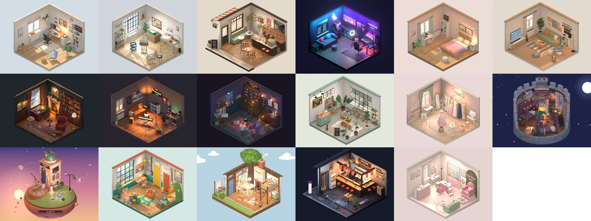
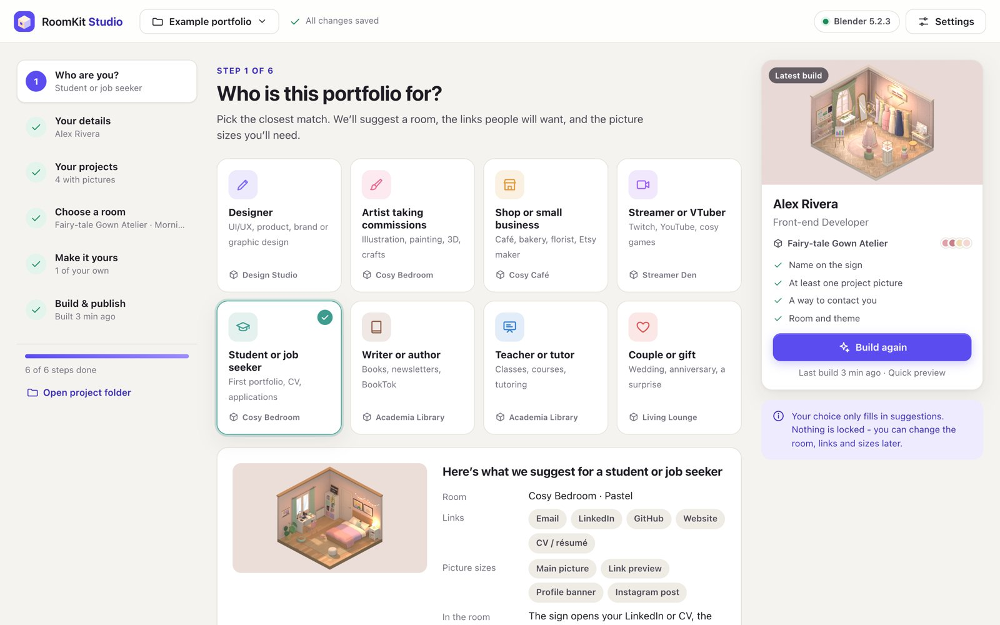
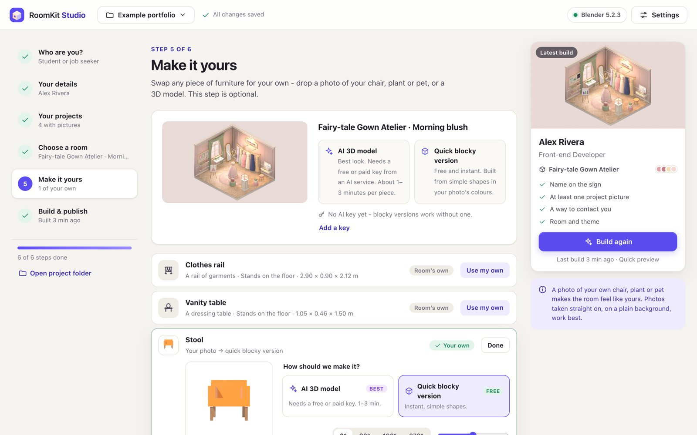
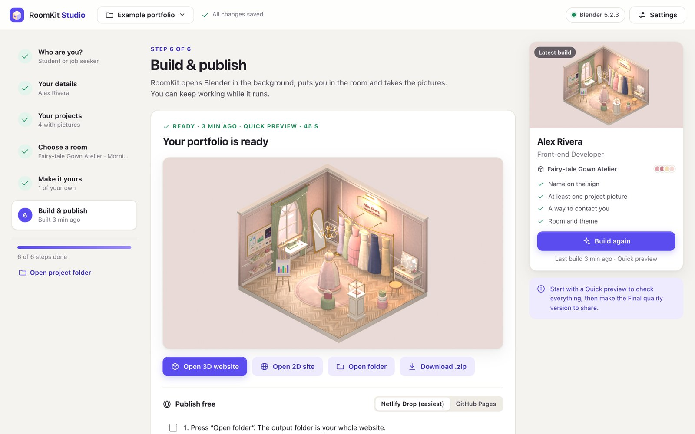

# Room Portfolio Kit: start here

Turn your work into a cosy 3D room that people remember. You get a 3D website visitors can turn and click, a matching one-page site, and ready-to-post images. You don't need to know Blender or code.



## The easy way (no typing)
1. Install **Blender 4.2 or newer** (free): [blender.org/download](https://www.blender.org/download/)
2. Double-click **Start.command** (Mac), **Start.bat** (Windows) or **start.sh** (Linux).
3. RoomKit Studio opens in your browser. Pick who you are, fill in your details, drag in your project pictures, choose one of 17 rooms, and click **Build my portfolio**.

Want your own chair, plant or pet in the room? Drop a photo onto it in **Make it yours**. The kit can turn it into a 3D model with an AI service (Meshy, fal.ai or a free Hugging Face option), or build a quick blocky version for free.

## What's inside
| File or folder | What it is |
|---|---|
| `STUDIO.md` | how to use the visual builder |
| `GUIDE.md` | the same things from the command line |
| `previews/` | every room in every colour theme (`00_all_17_rooms.png` shows them all) |
| `examples/` | a finished portfolio made from the sample profile |
| `templates/` | the 17 rooms |
| `tools/` | the builder, furniture, 3D-website and photo-to-3D tools |
| `research/` | the real products and places each room is modelled on |
| `SPEC.md` | rules for making new rooms |

## The rooms
- **Everyday rooms:** developer office, design studio, bakery café, streamer den, cosy bedroom, living lounge, dark-academia library, music studio, apothecary, plant shop.
- **Themed rooms:** fairy-tale gown atelier, wizard school dorm, tiny planet stargazer, animal city apartment, hearth cottage, lantern ramen bar, glow beauty bar.

The themed rooms are original designs. They use no characters, logos or names from films or books, so you can use them in a commercial portfolio.

## What RoomKit Studio looks like
| Who is it for? | Make it yours | Build |
|---|---|---|
|  |  |  |

## Get the kit
Click the green **Code** button above, then **Download ZIP**, and unzip it. If you use git, you can clone it instead:
```bash
git clone https://github.com/jennifersun09b/room-portfolio-kit.git
```

